# RTA Sound Monitor

**Live sound-level monitoring for worship spaces.** Measure A- and C-weighted levels from several RTA mics at once, see them on any device, predict what every section of the room is hearing, and keep a record of every service.

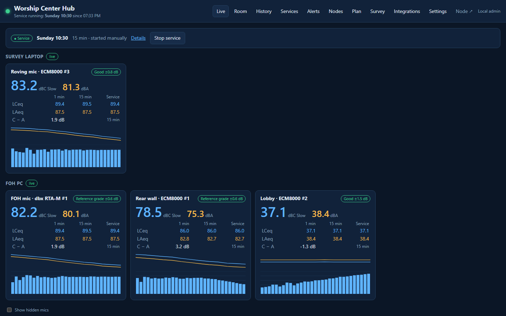

- **Measure:** calibrated dBC and dBA (Slow, Fast, 1-min, 15-min and whole-service Leq, peak), plus a 1/3-octave RTA for every mic.
- **Many mics, many PCs:** any PC with an audio interface becomes a *node*. One PC is the *Hub* that collects everything; nodes find it automatically.
- **Predict every seat:** survey each seating zone once with a roving mic. After that, the permanent mics predict each zone's level live, band by band.
- **Know when it's too loud:** warn and alarm levels per mic or zone, with an alert banner, a ProPresenter stage-display message, OSC, MIDI or webhooks.
- **Keep a record:** services start automatically from a weekly schedule, and a PDF report is saved after each one. Every second is logged and can be exported to CSV.
- **Share it:** a dashboard in any browser, NDI video and audio feeds for vMix, OBS and ProPresenter, and an open read-only API.

---

## Contents

1. [How it fits together](#how-it-fits-together)
2. [What you need](#what-you-need)
3. [Installing](#installing)
4. [First-time setup](#first-time-setup)
5. [Calibrating mics](#calibrating-mics)
6. [Zones and surveys](#zones-and-surveys)
7. [Services, history and reports](#services-history-and-reports)
8. [Alerts](#alerts)
9. [Integrations](#integrations)
10. [Best practices](#best-practices)
11. [Troubleshooting](#troubleshooting)
12. [Data, backups and security](#data-backups-and-security)
13. [Known limitations](#known-limitations)
14. [For developers](#for-developers)

---

## How it fits together

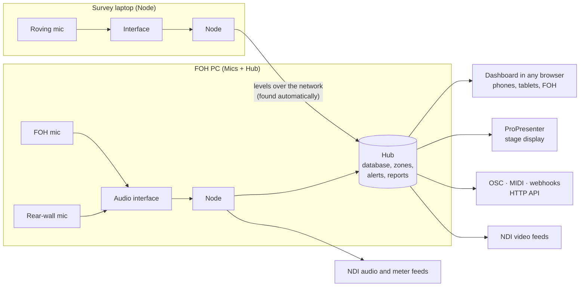

- A **node** captures audio from its interface, measures it, calibrates it, and sends the levels on. It keeps 7 days of readings, so nothing is lost if the Hub is offline for a while.
- The **Hub** stores every second, predicts the zones, runs the service schedule and alerts, writes reports, and serves the dashboard on port 5180.
- One PC can be both. That's the usual setup for a single FOH PC.

---

## What you need

| | |
|---|---|
| **PCs** | Windows 10 or 11, 64-bit. Any reasonably recent PC works. The Hub can be a modest office PC; nodes need a free USB/Thunderbolt port for the interface. |
| **Audio interface** | Anything with an **ASIO** driver and 48 V phantom power (Focusrite, Behringer, MOTU, …). WASAPI works as a fallback. |
| **Measurement mics** | Omni RTA/measurement mics such as the dbx RTA-M or Behringer ECM8000 (both need phantom power). Two or more permanent mics, plus one for surveying. |
| **Calibration** (recommended) | A 94 dB / 1 kHz acoustic calibrator. Or an SPL meter, or a phone app for a start. See [Calibrating mics](#calibrating-mics). |
| **Network** | Wired Ethernet on the same network/VLAN. Gigabit if you use NDI. |
| **Optional** | [NDI Tools](https://ndi.video) on PCs that publish or view NDI feeds. ProPresenter 7.9 or later for stage messages. |

---

## Installing

Download the latest **`RtaSetup-<version>.exe`** from the repo's [Releases page](https://github.com/jevan2000/rta-app/releases/latest) and run it on each PC (or [build it yourself](#for-developers)). It's a single installer with nothing else to download. Setup asks two questions:

**1. What does this PC do?**

| Choice | Use it for |
|---|---|
| **Mics and the Hub on this PC** | A single-PC setup, or the main FOH PC. |
| **Mics only** | A booth PC or laptop that sends readings to a Hub elsewhere. |
| **Hub only** | An office or server PC with no mics that runs the dashboard and logging. |

**2. How should RTA start?**

| Choice | Use it for |
|---|---|
| **When someone signs in** (with a status icon) | **PCs with audio interfaces.** Audio drivers (ASIO) usually need a signed-in user. For an unattended booth PC, set Windows to sign in automatically (see [Best practices](#unattended-pcs)). |
| **As a Windows service at boot** | **Hub-only PCs.** It runs with nobody signed in, and restarts itself if it ever crashes. |

Leave **"Allow RTA through Windows Firewall"** ticked. The Hub, the other nodes and NDI need it, and the rule only applies on private and domain networks.

When setup finishes:

- Open **http://localhost:5180** on the Hub, or **http://&lt;hub-ip&gt;:5180** from any phone, tablet or PC on the network.
- The first time you change anything, you're asked to **choose an admin password**. Viewing stays open to everyone on the network; changes need the password.
- The **status icon** in the notification area turns green, amber or red with the system's state, shows a pop-up when an alarm starts, and its menu opens the dashboard, node page and logs.

> **Upgrading:** run the new setup over the old one. It stops RTA cleanly, keeps all settings, calibration and history, and remembers your earlier choices.
> **Uninstalling** removes the program, service, firewall rule and shortcuts. Your data in `C:\ProgramData\RtaApp` is kept until you delete it.

<details>
<summary>Scripted / silent install</summary>

```bat
RtaSetup-1.0.2.exe /VERYSILENT /ROLE=Both /RUNAS=signin /TASKS="firewall,startup"
RtaSetup-1.0.2.exe /VERYSILENT /ROLE=Hub  /RUNAS=service /TASKS="firewall"
```
`/ROLE` is `Both`, `Node` or `Hub`; `/RUNAS` is `signin` or `service`. The choices are saved in `C:\ProgramData\RtaApp\app.json`.
</details>

---

## First-time setup

### 1. Choose the audio interface on each node

On each PC with mics, open **http://localhost:5180/node/** (or **Node ↗** in the dashboard, or the status icon's menu) and click **Settings**:

- **Audio device:** pick the interface's **ASIO** driver. Leave 48 kHz unless you have a reason to change it.
- **Inputs:** tick the inputs with mics, give each a name (e.g. *FOH mic*), and type which physical mic is plugged in (e.g. *dbx RTA-M #1*).
- **Hub:** leave it on *Automatically*. On a separate network segment, enter the Hub's address instead.

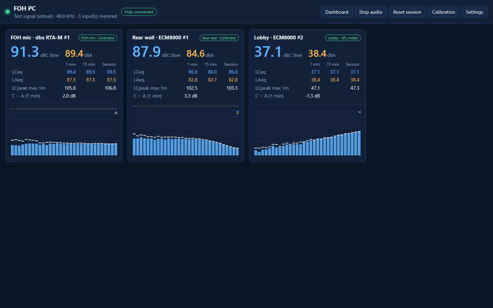

### 2. Accept new nodes on the Hub

A new node shows up on the Hub's **Nodes** page as *Pending* and sends nothing until you press **Accept**. Once accepted, it sends everything it has logged in the meantime. The node on the Hub's own PC is accepted automatically. You can rename mics or hide unused inputs here too.

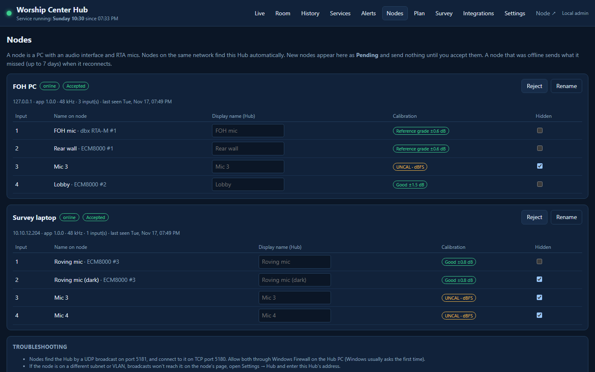

### 3. Calibrate every mic

See [Calibrating mics](#calibrating-mics). Until a mic is calibrated, its readings are relative dBFS values (marked **UNCAL**), not dB SPL.

### 4. Draw the room, then survey the zones

See [Zones and surveys](#zones-and-surveys).

### 5. Set the service schedule and alert levels

On **Services**, add your weekly services (e.g. *Sunday 9:00, 75 min*). On **Alerts**, set warn and alarm levels with your leadership. See [Best practices → targets](#choosing-targets).

### 6. Hook up ProPresenter and anything else

See [Integrations](#integrations).

---

## Calibrating mics

An audio interface only knows "how close to full scale". Calibration turns that into real **dB SPL**. In the node page, click **Calibration**, pick the input and a method:

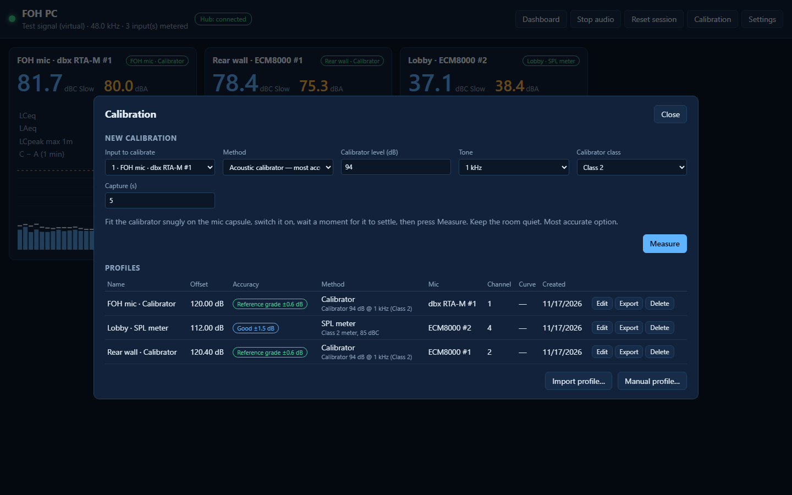

| Method | Accuracy | How |
|---|---|---|
| **Acoustic calibrator** | Reference grade (±0.4–0.8 dB) | Fit the calibrator snugly over the capsule, switch it on, press **Measure**. 94, 104 or 114 dB at 1 kHz (or a 250 Hz pistonphone). |
| **Match an SPL meter** | Good (±1–1.5 dB) with a Class 1/2 meter; unreliable (±3 dB) with a consumer meter | Put the meter right next to the mic, play steady pink noise at about 85 dB, set the meter to the same weighting and to Slow/Leq, type its reading, press **Measure**. |
| **Copy from another mic** | The source's accuracy + about 0.5 dB | Hold this mic right next to an already-calibrated one, play pink noise, press **Measure**. |
| **Phone meter app** | **Unreliable** (≈ ±3 dB on iPhone, worse on Android) | Like meter match, with the phone as the reference. Flagged everywhere as unreliable. |
| **Estimate from specs** | **Very rough** (±6 dB or worse) | From the mic's sensitivity and the interface's specs, with no measurement. A stopgap only. |

Each profile shows its accuracy (*Reference grade*, *Good*, *Unreliable*, *Very rough*), and the dashboard shows the badge on every reading. Profiles can be exported and imported between PCs.

**No calibrator yet?** Calibrate one mic with the best reference you have, then use **Copy from another mic** for the rest. All the mics will then agree with each other, which is what zone prediction depends on. When a calibrator arrives, recalibrate that one mic and copy again.

---

## Zones and surveys

The permanent mics can't be in every seat, so RTA learns how each section of the room relates to them.

### 1. Draw the plan

On **Plan**, draw the room in metres:
- The room outline, stage, seating blocks, aisles and walls.
- Your **zones**, as rectangles or freehand shapes.
- A photo or exported floor plan as a background to trace over, if you have one.
- A second floor (e.g. a balcony), if needed.

Then use **Place mic** to put each **permanent** mic where it really is, and mark the survey mic as **Roving**.

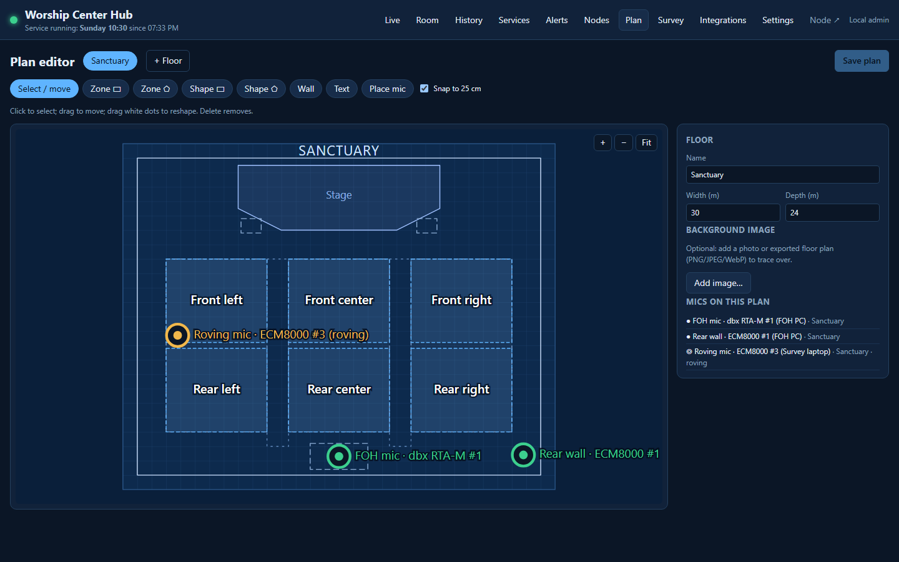

### 2. Survey each zone

Take the roving mic (usually a laptop running as a node) to a typical seat in the zone. On **Survey**, pick the zone and press **Start**. Leave it running for at least a minute during a service or with pink noise. The confidence bar fills as the readings settle. Then press **Stop & save**.

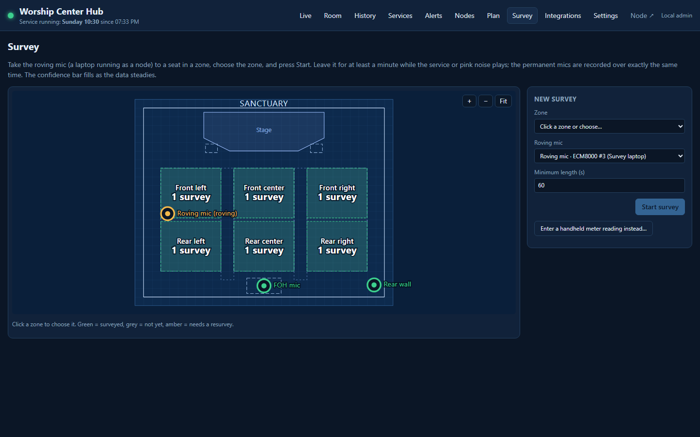

RTA records the roving mic and every permanent mic over exactly the same time. It learns the difference for each frequency band, so its predictions keep up when the mix changes (say, more bass in a worship set). A single dB offset couldn't do that.

### 3. Watch the room

**Room** shows the plan with each zone coloured by its predicted level (blue → green → amber at warn → red at alarm), live mic readings, and a confidence figure for each zone. Click a zone for the same graphs as a mic: level over time, Leq, RTA, C − A, spectrogram and histogram.

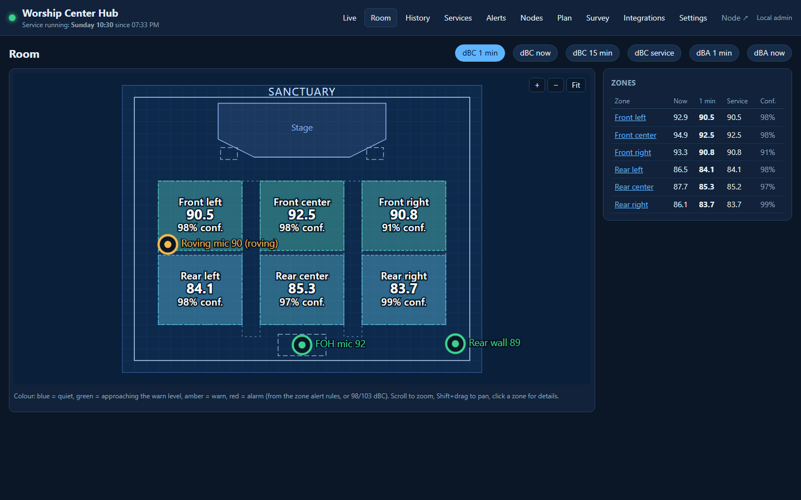

Zones are logged like mics, so they appear in History, service reports and alerts. If a permanent mic is moved on the plan or taken away, its zones are flagged *resurvey*. Recalibrating a permanent mic is corrected for automatically.

---

## Services, history and reports

- **Services** start and end from the weekly schedule, or by hand from the Live page. Logging runs all the time; a service just labels a stretch of time.
- **Mic detail:** click any mic or zone for level over time with warn and alarm lines, Leq tiles, the RTA with peak hold, the C − A trend, and optional spectrogram and histogram.

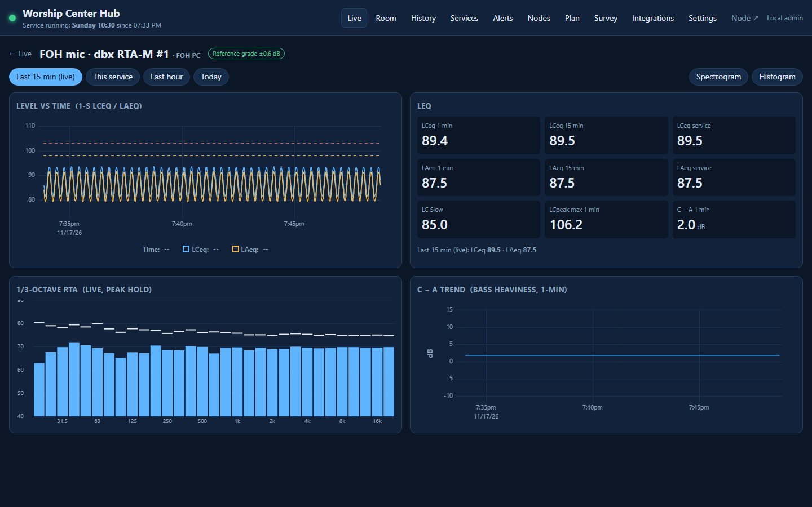

- **History** graphs any mics and zones over the last hour, day or week, or over a chosen service, and exports CSV.

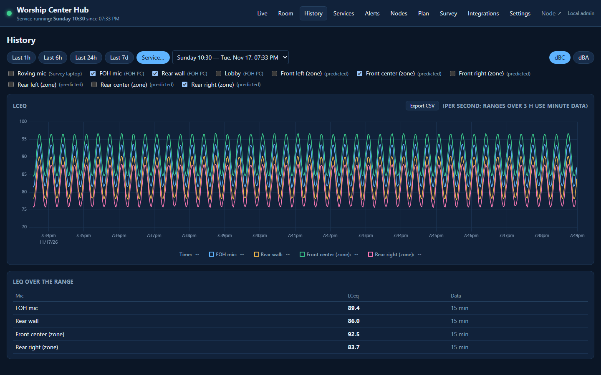

- **Service summary:** every service gets a page with the Leq for each mic and zone, the highest 1-minute Leq, peaks, time spent above the warn and alarm levels, and alerts.

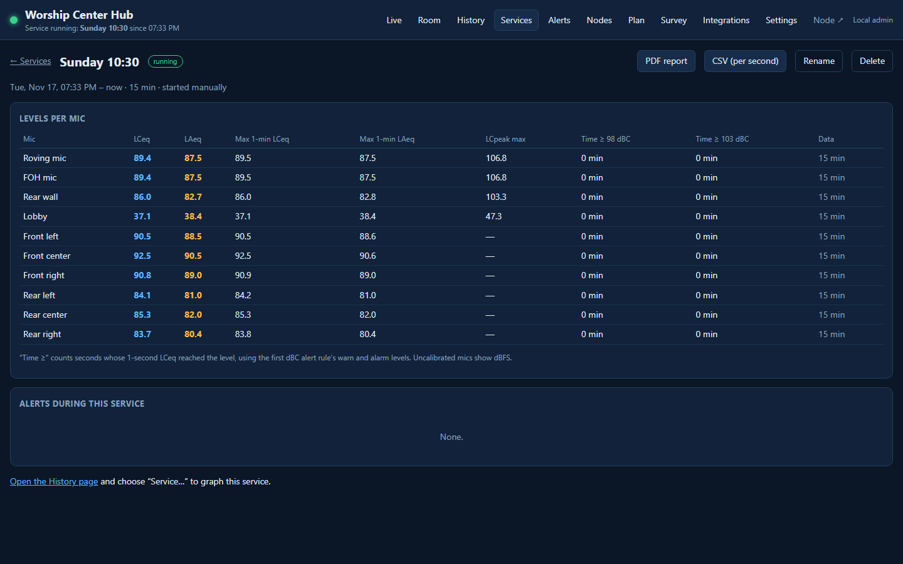

- **PDF reports** are saved automatically about 90 seconds after each service ends, to a folder you choose (on **Integrations → Service reports**; a OneDrive or network folder works well). You can also open them from any service's page.

<p align="center">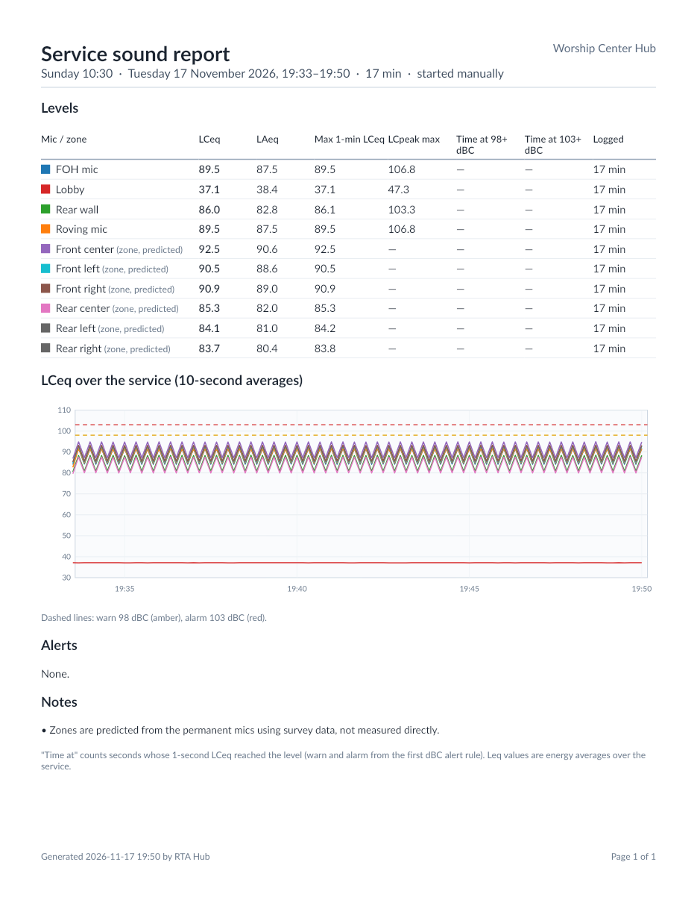</p>

---

## Alerts

On **Alerts**, each rule watches one mic, every mic, one zone or every zone, using a measure such as dBC Slow, 1-min Leq, 15-min Leq, service Leq or peak. A rule has:
- a **warn** level and an **alarm** level
- a **hold time**: the level must stay over the limit this long before the alert starts
- **hysteresis**: the level must drop this far below the limit before the alert clears

Active alerts show as a banner on every page, colour the cards, go to ProPresenter, OSC, MIDI and webhooks, and are logged in the service reports.

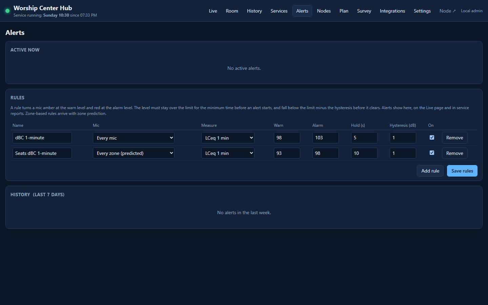

---

## Integrations

Everything is set on the dashboard's **Integrations** page. Every section has a **Test** button and a live status.

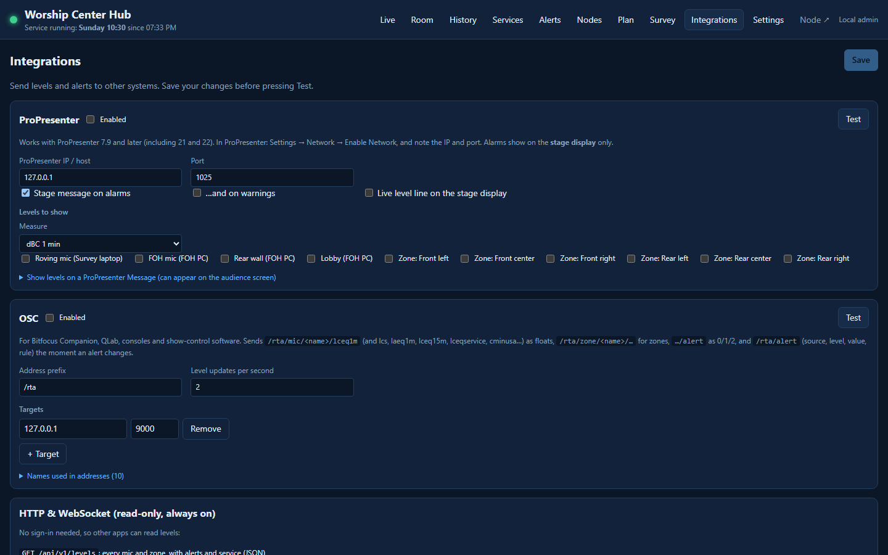

| Integration | What it does |
|---|---|
| **ProPresenter** (7.9+, incl. 21 & 22) | Shows *"LEVEL ALARM: Balcony 104 dBC (limit 103)"* as a **stage-display message**, cleared automatically. Optionally shows a live level line on the stage display. An opt-in *Message* readout (it can appear on the audience screen) is off by default. In ProPresenter, turn on *Settings → Network → Enable Network*. |
| **OSC** | `/rta/mic/<name>/lceq1m` (and `lcs`, `laeq1m`, `lceq15m`, `lceqservice`, `cminusa`…) as floats, `…/alert` as 0/1/2, and an `/rta/alert` message the moment an alert changes. For Bitfocus Companion, QLab and consoles. |
| **HTTP / WebSocket** (read-only, no password) | `/api/v1/levels` (JSON), `/api/v1/levels/<name>/lceq1m` (just the number, e.g. `84.2`, handy for a vMix or OBS text source), and `ws://<hub>:5180/ws/v1/levels`. |
| **Webhooks** | JSON POSTs on alert start, escalate and clear and on service start and end, for Teams/Slack workflows, Home Assistant, Zapier and similar. |
| **MIDI** | A control change per chosen level (scaled to 0–127), and notes held while a warning or alarm is active. Use a hardware port or loopMIDI. |
| **NDI** | Per input on each node: raw **audio** and a **meter** video with levels attached as data. From the Hub: an **RTA Dashboard** frame (720p/1080p/4K) and a feed per zone. Needs [NDI Tools](https://ndi.video). Bandwidth is estimated, with warnings. |

<p align="center">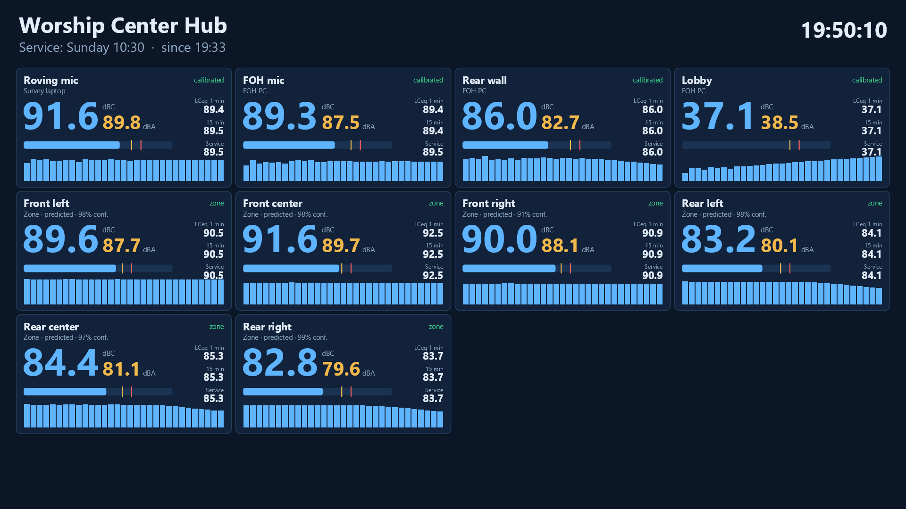<br><em>The “RTA Dashboard” NDI feed, as it appears in vMix, OBS or ProPresenter.</em></p>

---

## Best practices

### Mic placement
- **Permanent mics** should "hear" the PA the way the congregation does: at or slightly above ear height, with a clear line to the main speakers. Mount them on a wall bracket, balcony rail or ceiling drop. Keep them about 1 m or more from walls and corners (which add bass), and away from subwoofers, HVAC vents and people's conversations.
- **Put one mic at the mix position.** It's the level the engineer is listening to, and it's a good anchor for the zone models.
- **Two to four permanent mics** spread around the room give better predictions than one. Once installed, **don't move them**: their zones will need a resurvey.
- **Point measurement mics toward the stage.** They're omnidirectional, but the high end is most accurate head-on.

### Gain and calibration
- **Set the preamp gain once, then leave it.** Calibration is only valid at that gain. Note the setting in the calibration profile, and tape the knob or lock it in the interface's software.
- **Leave headroom.** After calibrating, the profile's *offset* is roughly the loudest peak the input can measure before clipping. Aim for **125 dB or more** so a kick drum can't clip. The node warns if an input clips.
- **Turn off Windows "audio enhancements"** for the interface, and use the **ASIO** driver.
- **Check calibration** every month or so, and before big events. It only takes 30 seconds with a calibrator. Recheck after anyone touches the gain, swaps a mic or changes the interface.

### Surveying
- Survey **during a real service or rehearsal**, or with pink noise at a typical worship level. Quiet-room surveys predict poorly.
- Sit in a **typical seat**, roving mic at **seated ear height** (about 1.1–1.2 m), away from walls and people talking.
- Let it run **at least 60 seconds**, longer during varied music. Wait for a high confidence figure.
- For big zones, survey two or three seats and set the zone to **Average all surveys** (Plan → select the zone).
- **Resurvey** after moving a permanent mic, changing the PA, its tuning or processing, or making big changes to the room (risers, curtains, seating).

<a id="choosing-targets"></a>
### Choosing targets
Set targets with your pastors and worship leaders, and watch both weightings:
- **dBA** follows how loud people perceive the music and relates to hearing risk.
- **dBC** includes the low end that people *feel*.
- A large **C − A** (more than about 10–15 dB) means the mix is bass-heavy.

For hearing-risk context, the NIOSH guideline is **85 dBA averaged over 8 hours**, halving the safe time for every 3 dB louder (91 dBA ≈ 2 hours, 94 dBA ≈ 1 hour). Many churches set a 15-minute or service LAeq target somewhere in the high 80s to mid 90s dBA, with a dBC ceiling for the low end. The defaults here (warn 98 / alarm 103 dBC, 1-minute Leq) are only a starting point.

### Network
- Wire every RTA PC to the same network and VLAN. Discovery uses a broadcast, which doesn't cross routers (use *Settings → Hub → At a fixed address* if it must).
- Give the Hub a fixed IP (a DHCP reservation) so bookmarks and integrations keep working.
- Use gigabit for NDI, and keep video feeds at 5–10 fps; levels don't change faster than that.

<a id="unattended-pcs"></a>
### Unattended PCs
- PCs with interfaces: install with **start at sign-in** and enable **automatic sign-in** (Microsoft's *Autologon* tool, or `netplwiz`). Use a dedicated local account.
- Set the power plan to **never sleep**, and set Windows Update **active hours** to cover service times.
- In the BIOS, set **power on after power loss**, if available.
- Hub-only PCs can run **as a service** and need none of this.

---

## Troubleshooting

| Symptom | Try |
|---|---|
| A node says *"Looking for a Hub…"* | Is the Hub running? Is the firewall rule installed (rerun setup with it ticked)? Is the node on the same subnet? If not, set the Hub address on the node page. |
| A node is *"waiting for approval"* | Accept it on the Hub's **Nodes** page. |
| The audio device won't start | Close other programs using the ASIO driver (DAWs, Smaart). Check the interface's software isn't locking the sample rate. Restart RTA from the status icon. |
| Levels look wrong | Has someone changed the gain since calibrating? Is the right profile assigned to the input (node page → Settings)? Are Windows enhancements off? |
| Clipping warning | Turn the preamp gain down, then **recalibrate**. |
| A zone says *resurvey* | A permanent mic was moved or removed on the plan. Survey the zone again. |
| ProPresenter *"can't reach"* | In ProPresenter: *Settings → Network → Enable Network*. Check the IP and port, and the firewall on the ProPresenter PC. Press **Test**. |
| No NDI sources | Install NDI Tools. Check the firewall rule, and that both PCs are on the same subnet. On the Integrations page, **Find sources** shows what's visible. |
| Forgot the admin password | On the Hub PC: quit RTA (status icon → Exit, or stop the *RtaApp* service), delete `C:\ProgramData\RtaApp\admin.json`, start RTA again and set a new password from that PC. |

**Logs** are in `C:\ProgramData\RtaApp\logs` (status icon → *Open log folder*), one file per day, kept 14 days.

**Ports:**

| Port | Use |
|---|---|
| TCP 5180 | Dashboard, API, node connections |
| UDP 5181 | Hub discovery |
| NDI's own ports | mDNS 5353, TCP 5960 and up |

---

## Data, backups and security

- **Where data lives:** `C:\ProgramData\RtaApp`, containing:
  - settings (`node.json`, `hub.json`, `app.json`)
  - calibration profiles (`calibration\`)
  - the plan (`plan.json`, `plan-images\`)
  - the Hub database (`hub.db`)
  - the node's 7-day buffer
  - automatic backups (`backups\`), reports and logs
- **Updates keep everything.** Installing a new version over an old one never touches this folder (except `app.json`, which keeps your role, start mode and any address or port you changed). Uninstalling leaves it too.
- **Power cuts:** settings are written safely (flushed to disk, previous version kept as `.bak`). If a file is ever damaged, RTA sets it aside as `<name>.corrupt-<time>`, uses the previous version and says so on the backup panel, rather than starting from defaults.
- **Retention:** per-second data is kept for 1 year by default (Settings); 1-minute summaries are kept forever. Expect about 1 GB per mic per year.
- **Security:**
  - Set the **admin password** straight away.
  - Viewing is open to the local network by design; every change needs the password, and the first password can only be set on the PC itself.
  - Keep RTA on your private church network. **Don't port-forward it to the internet.**
  - In sign-in mode, anyone who can sign in to that PC can change files in the data folder, so limit booth PCs to trusted accounts.

### Backups, and moving to a new PC

**Backup & restore** is on the dashboard's **Settings** page, and in **Settings** on each node page (for node-only PCs).

- **Download backup** saves one `.rtabackup` file with this PC's inputs, audio device, warn/alarm levels and calibration profiles; on the Hub, its settings, alert rules, integrations, NDI, floor plan, zones, surveys, mic names and schedule; and the admin password. Tick **Include logged history** for a complete copy (much larger).
- **Automatic backups** (settings only) are saved:
  - every day (kept for 2 weeks)
  - the first time a new version runs, with the old version's settings (last 5 kept)
  - before every restore (last 5 kept)

  Each one has **Restore…** next to it, which is the quickest way to undo a change or an update.
- **Restore from file…** shows what's in the backup and lets you choose the parts. RTA saves a backup of the current settings, restarts, and applies the restore before anything else starts. Restoring settings keeps this PC's logged history; only a full backup with **logged history** ticked replaces it.
- **Replacing a PC:** install RTA on the new PC with the same role, restore the old PC's backup and tick **This PC replaces …**. The new PC takes over the old one's identity, so its mics, zones, surveys and history line up (restore a full backup to bring the history across). Turn the old PC off first so the two don't both report as the same node.
- **Setting up an extra PC like an existing one:** restore that PC's backup with **This PC replaces …** unticked. Only the settings are copied; the new PC keeps its own identity.

Keep a recent backup somewhere off the PC (a USB stick or a shared drive), especially after calibrating or surveying.

---

## Known limitations

- **Field testing:** v1.0.2 has been tested with built-in test signals, WASAPI capture and the NDI 6 runtime on one PC. The following haven't been tried on real hardware yet:
  - ASIO interfaces, especially under automatic sign-in
  - multi-PC discovery across a real network
  - a real ProPresenter 21/22, including whether its API wants a password and its exact Message token format
  - MIDI devices
  - NDI viewers such as vMix, OBS or Studio Monitor

  Please report anything odd.
- **Zone predictions** are made live on the Hub. If a node was offline and later sends its backlog, the mic history is filled in, but the zone history for that gap isn't.
- **Mic identity** is *PC + input number*. Moving a mic to another input or PC starts a new history entry, so rename it on the Nodes page to keep things tidy.
- **Mic response files** (REW/.frd) correct the RTA bands only, not the broadband dBA/dBC.
- **Windows enhancements:** with WASAPI (non-ASIO) capture, Windows "audio enhancements" must be off and the sample rate is whatever Windows Sound settings say.

---

## For developers

Requires the **.NET 10 SDK**, **Node.js 20+**, and, for the installer, **Inno Setup 6** (`winget install JRSoftware.InnoSetup`).

```bash
dotnet run --project src/Rta.App --no-launch-profile -- --DataDir .devdata
```
Then open http://localhost:5180; the app starts on a built-in **test signal**, so no hardware is needed. Useful options:
- `--Mode Both|Node|Hub`
- `--Urls http://0.0.0.0:5180`
- `--DataDir <folder>`

`.claude/launch.json` has ready-made configurations, including a two-PC demo on one machine.

```bash
dotnet test
```
```bash
cd web && npm run dev
```
`npm run dev` serves the dashboard with hot reload on :5173, proxying to the app.

```bash
powershell -ExecutionPolicy Bypass -File installer/build-installer.ps1
```
This builds the dashboard and publishes everything self-contained, writing `artifacts/RtaSetup-<version>.exe`.

| Folder | What's in it |
|---|---|
| `src/Rta.Core` | DSP (A/C weighting, 1/3-octave filters, Leq), calibration, records, zone model |
| `src/Rta.Audio` | ASIO / WASAPI / test-signal capture, MIDI out |
| `src/Rta.App` | The app: node, Hub, integrations, reports, NDI, web host |
| `src/Rta.Tray` | Status icon |
| `web/` | Dashboard (React + TypeScript + Vite) |
| `installer/` | Inno Setup script and build script |
| `tests/` | Unit tests |

Design decisions and the reasoning behind them are in **[DESIGN.md](DESIGN.md)**.

### Acknowledgements and licences
- Built with:
  - .NET / ASP.NET Core
  - [NAudio](https://github.com/naudio/NAudio) (MIT)
  - [SkiaSharp](https://github.com/mono/SkiaSharp) (MIT)
  - [QuestPDF](https://www.questpdf.com) (Community licence: free for organisations under US$1M annual revenue)
  - [uPlot](https://github.com/leeoniya/uPlot) (MIT)
  - React (MIT)
  - SQLite
- **NDI®** is a registered trademark of Vizrt NDI AB. RTA uses the NDI runtime installed by NDI Tools and doesn't redistribute it. If you distribute this app, follow the NDI SDK licence terms.
- Measurements are measurement-grade, not a certified IEC 61672 sound level meter. A and C weighting meet Class 1 tolerances in testing, but accuracy depends on your mics and calibration.
